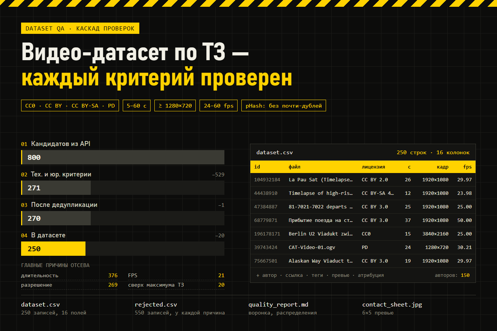
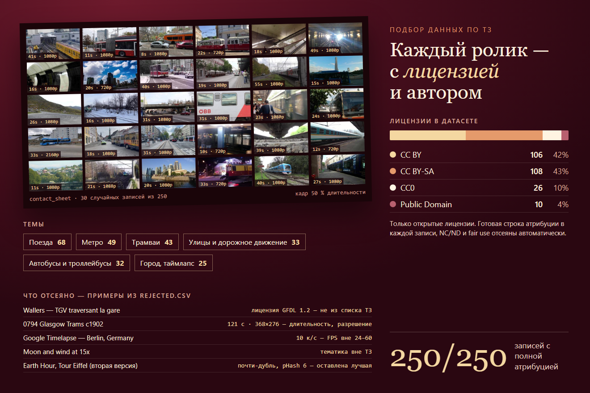

# Датасет на заказ: подбор данных по ТЗ с проверкой качества




## Что это за услуга

Вам нужен набор данных для обучения модели, тестов или исследования — например,
200 коротких роликов определённой тематики. Вы присылаете требования (ТЗ):
сколько записей, какие лицензии допустимы, длительность, разрешение и т. д.
Я собираю подборку **только из легальных открытых источников**, автоматически
проверяю каждую запись по каждому пункту ТЗ, убираю дубли и сдаю:

- таблицу с метаданными и ссылками на файлы;
- список отсеянного с причиной у каждой записи;
- отчёт о качестве с цифрами — по нему видно, что критерии ТЗ выполнены.

Критерии приёмки фиксируются до начала работы. Запись, которая им не соответствует,
заменяется в рамках заказа.

Этот проект — **реальный прогон** конвейера на открытых данных Викисклада
(Wikimedia Commons), все цифры ниже — из настоящего результата.

## Пример ТЗ (выдуманный заказчик)

> Датасет коротких видео «город и транспорт» для обучения модели:
> 150–250 роликов с **открытой лицензией** (CC0 / CC BY / CC BY-SA / Public Domain),
> длительность **5–60 с**, разрешение **не ниже 1280×720**, **24–60 к/с**,
> **без дублей и почти-дублей**; таблица метаданных; отчёт о качестве.

## Результат прогона

| Этап | Записей |
|---|---:|
| Кандидатов собрано через официальный API | 800 |
| Прошли технические и юридические критерии | 271 |
| После удаления почти-дублей | 270 |
| **В итоговом датасете** | **250** |

- Лицензии: CC BY-SA — 108, CC BY — 106, CC0 — 26, Public Domain — 10.
- Атрибуция (автор + лицензия + ссылка) есть у **250 из 250** записей.
- Темы: Поезда — 68, Метро — 49, Трамваи — 43, Улицы и дорожное движение — 33, Автобусы и троллейбусы — 32, Город, таймлапс — 25.
- Разных авторов: 150.

Файлы результата — в папке [`output/`](output/):

| Файл | Что внутри |
|---|---|
| [`dataset.csv`](output/dataset.csv) | итоговая таблица: id, название, ссылка на файл и страницу, автор, лицензия, ссылка на текст лицензии, длительность, ширина, высота, FPS, размер, тема, теги, кадр-превью, готовая строка атрибуции |
| [`rejected.csv`](output/rejected.csv) | всё, что отсеяно, — с этапом и причиной («длиннее 60 с», «лицензия не открытая: CC BY-NC…», «почти-дубль записи …») |
| [`quality_report.md`](output/quality_report.md) | воронка, распределения по длительности / разрешению / FPS / темам, сводка лицензий, 25 случайных записей для ручной проверки |
| [`contact_sheet.jpg`](output/contact_sheet.jpg) | сетка 6×5 кадров из случайной выборки — содержимое видно за 10 секунд |
| [`previews/`](output/previews/) | кадр из середины каждого ролика (320 px) |

CSV — в кодировке UTF-8 с BOM, разделитель запятая (стандарт для Python/pandas;
Excel открывает через «Данные → Из текста/CSV»).

## Как устроена проверка качества (каскад)

Дешёвые проверки — первыми, дорогие — только для тех, кто прошёл предыдущие.
Видео целиком **не скачивается**.

1. **Сбор** (`collect.py`). Официальный MediaWiki API Викисклада: обход
   тематических категорий с подкатегориями, кандидаты с запасом (×3–4 к нужному
   объёму), сырые метаданные сохраняются в `raw/`.
2. **Метаданные** (`check.py`, этап A). По данным API, без обращения к файлу:
   тип файла, лицензия, наличие автора, длительность, ширина и высота.
   Здесь отсеивается 64 % кандидатов.
3. **Частота кадров** (`check.py`, этап B). Из заголовка видеопотока, который
   хранит сам Викисклад; если там пусто или явная ошибка — `ffprobe` по ссылке
   (читает несколько килобайт начала файла).
4. **Почти-дубли** (`dedup.py`). По 3 кадра на ролик (20 / 50 / 80 % длительности)
   в виде маленьких миниатюр, перцептивный хэш (pHash). Два ролика с похожими
   кадрами — одна группа; остаётся версия с лучшим разрешением. Так ловятся
   перезаливки, обрезанные копии и фрагменты одной и той же съёмки.
   В этом прогоне склеена 1 пара (два ролика Earth Hour с Эйфелевой башней,
   дистанция 6), а ближайшая пара действительно разных роликов — 14:
   порог 10 проходит между ними.
5. **Отчёт** (`report.py`). Итоговая выборка (если записей больше максимума ТЗ —
   равномерно по темам), CSV, контактный лист, отчёт о качестве и список
   из 25 случайных записей для проверки человеком.

У каждой отсеянной записи сохраняется **этап и причина** — заказчик видит,
что отбор честный, а не «взяли первые 200».

Вежливость к источнику: пауза между запросами, User-Agent с описанием проекта,
ожидание по `Retry-After` при ответе 429, не больше 2 одновременных обращений
к серверу файлов, только стандартный размер миниатюр.

## Что получает заказчик

- `dataset.csv` + `rejected.csv` + `quality_report.md` + контактный лист;
- по желанию — сами файлы (скачиваются по ссылкам из таблицы отдельной командой),
  выгрузка в Excel / JSON / Parquet, раскладка по папкам по темам;
- скрипты и `config.yaml`, чтобы пересобрать датасет самостоятельно.

## Как поменять критерии под другое ТЗ

Все требования — в одном файле [`config.yaml`](config.yaml):

```yaml
criteria:
  licenses_allowed: ["CC0", "CC BY ", "CC BY-SA ", "Public domain", "PD"]
  duration_min_s: 5
  duration_max_s: 60
  min_width: 1280
  min_height: 720
  fps_min: 24
  fps_max: 60
dedup:
  max_distance: 10      # строже — меньше, мягче — больше
collect:
  themes:               # тема -> категории источника
    "Трамваи":
      - {category: "Videos of trams", depth: 2}
```

Например, «только CC0, вертикальные, до 15 секунд» — правка трёх строк.
Другая тематика — другой список категорий.

## Как запустить

Нужны Python 3.10+ и ffmpeg (ffprobe) в PATH. Windows:

```bat
run_all.bat
```

Скрипт сам создаст окружение `.venv`, поставит зависимости из `requirements.txt`
и выполнит 4 шага подряд. Можно запускать шаги по отдельности:

```powershell
.\.venv\Scripts\python.exe collect.py   # ~10 мин, ~100 запросов к API
.\.venv\Scripts\python.exe check.py     # ~3 мин
.\.venv\Scripts\python.exe dedup.py     # ~17 мин на 270 роликов: миниатюры строятся на сервере
.\.venv\Scripts\python.exe report.py    # секунды
```

Повторный запуск `check.py` и `dedup.py` использует кэш (`raw/`, `tmp/frames/`).

## Правовые моменты

- Берутся **только** записи с открытыми лицензиями из списка ТЗ; NC (некоммерческие),
  ND (без производных), fair use и записи без автора отсеиваются автоматически.
- Лицензия и автор берутся из официальных метаданных Викисклада
  (`LicenseShortName`, `LicenseUrl`, `Artist`) — так, как их указал загрузивший.
- Для каждой записи готова строка атрибуции; при использовании CC BY / CC BY-SA
  нужно указывать автора и лицензию, производные от CC BY-SA распространяются
  на тех же условиях.
- Мы продаём **работу по подбору, проверке и метаданные**, а не права на сами
  произведения: права остаются у авторов, использование — по условиям их лицензий.
- Не используются источники, где выгрузка запрещена правилами (YouTube и т. п.),
  и сервисы, требующие обходить ограничения.
- Узнаваемые люди и номера автомобилей автоматически не проверяются — если это
  важно для вашей задачи, обсуждается отдельно (дополнительная ручная разметка).

## Файлы проекта

- `config.yaml` — критерии ТЗ и источники;
- `commons.py` — вежливый клиент API Викисклада;
- `collect.py`, `check.py`, `dedup.py`, `report.py` — шаги конвейера;
- `run_all.bat` — запуск всего конвейера;
- `raw/` — сырые ответы API (кандидаты, метаданные потоков);
- `work/` — промежуточные результаты по шагам;
- `output/` — результат для заказчика;
- `docs/` — картинки для этого описания.

Технологии: Python, MediaWiki API, ffmpeg/ffprobe, Pillow, ImageHash (pHash), PyYAML.
