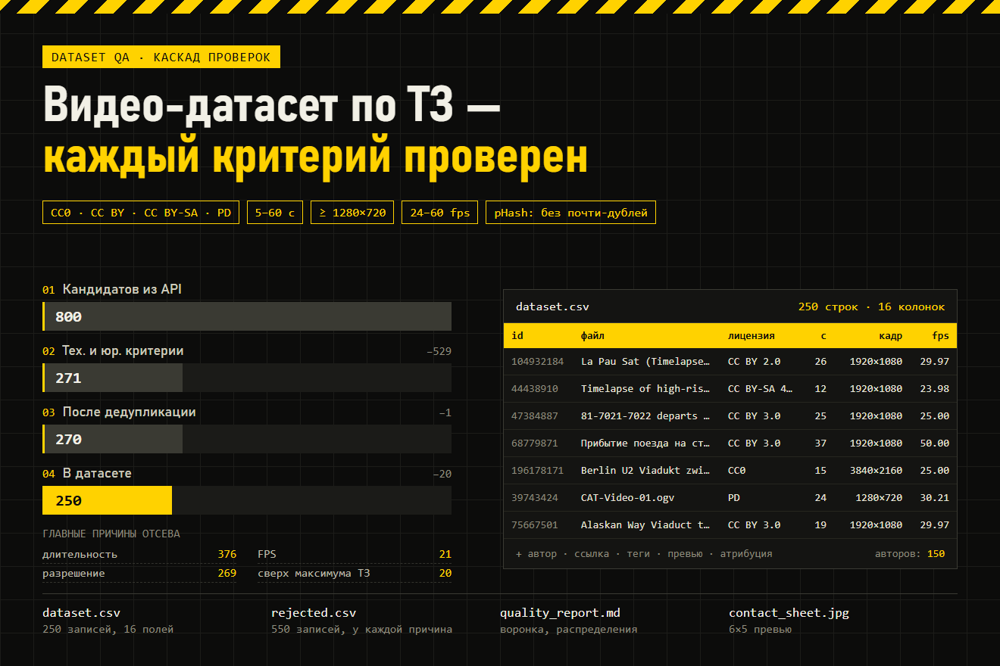

# Custom dataset sourcing with verified acceptance criteria

**The service:** you send a spec (how many items, allowed licenses, duration,
resolution, etc.). I collect items **only from legal, openly licensed sources via
official APIs**, check every item against every criterion automatically, remove
duplicates and near-duplicates, and deliver a metadata table, a list of everything
rejected (with the reason), and a quality report with numbers.

This repo is a **real run** of the pipeline on Wikimedia Commons.

## Example spec (fictional client)

> Short "city & transport" videos for model training: 150–250 clips, open license
> (CC0 / CC BY / CC BY-SA / Public Domain), 5–60 s, at least 1280×720, 24–60 fps,
> no duplicates or near-duplicates; metadata table; quality report.

## Result of this run

| Stage | Items |
|---|---:|
| Candidates collected via the official API | 800 |
| Passed technical and license criteria | 271 |
| After near-duplicate removal | 270 |
| **Final dataset** | **250** |

Full attribution (author + license + source page) for **250/250** items.

## Quality cascade (no full video downloads)

1. `collect.py` — MediaWiki API, topic categories + subcategories, 3–4× oversampling.
2. `check.py` — A: license, author, type, duration, resolution from API metadata;
   B: frame rate from stream headers stored by Commons, `ffprobe` by URL as fallback.
3. `dedup.py` — 3 frames per clip (standard-size thumbnails), perceptual hash (pHash),
   near-duplicate groups merged, best resolution kept.
4. `report.py` — `dataset.csv`, `rejected.csv` (stage + reason for each item),
   `contact_sheet.jpg`, `quality_report.md` (funnel, distributions, licenses,
   25 random items for human spot-check).

All criteria live in `config.yaml`; a new spec usually means editing a few lines.
Run everything with `run_all.bat` (Python 3.10+, ffmpeg in PATH).

## Legal notes

Only open licenses from the spec; NC/ND/fair-use and items without an author are
rejected automatically. Each row has a ready-made attribution string. What is sold
is the sourcing, verification and metadata work — rights stay with the authors and
use follows their licenses. Polite crawling: request delays, descriptive User-Agent,
`Retry-After` respected, max 2 concurrent media requests.
